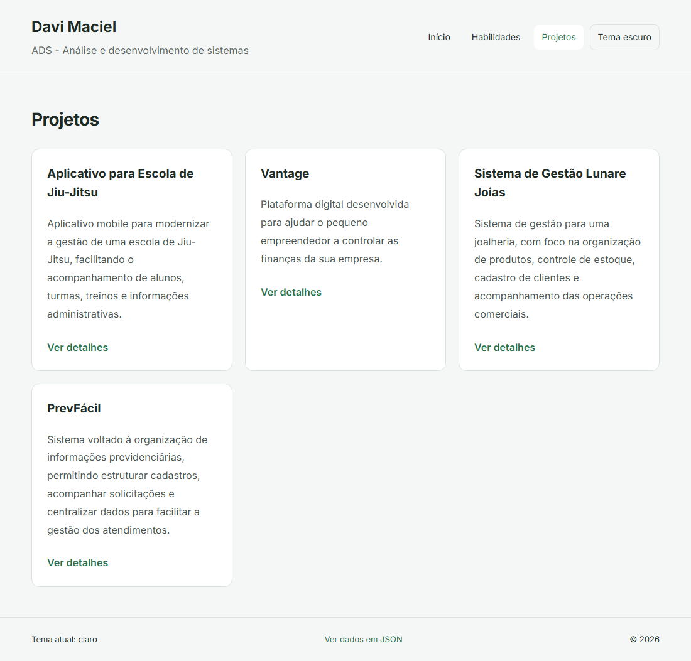
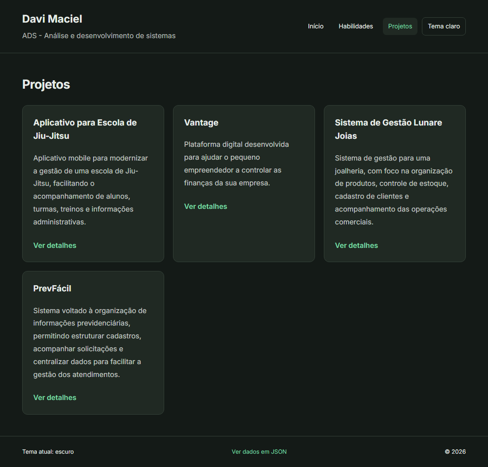

# Perfil do Estudante — Versão 2 (com classes)

**Autor:** Davi Maciel

Reescrita da versão 1 usando classes. Para quem visita o site nada muda: as mesmas páginas, o mesmo tema com cookie, o mesmo 404 e a mesma API em JSON. O que mudou é o código por dentro: os arrays associativos `$perfil` e `$projetos` deram lugar aos objetos das classes `Perfil` e `Projeto`.

## Como executar

```bash
cd projeto-perfil-v2
php -S localhost:8000 -d display_errors=1 -d output_buffering=0
```

Abra [http://localhost:8000](http://localhost:8000). É necessário ter o PHP no PATH.

## Estrutura

```text
projeto-perfil-v2/
├── index.php
├── estilo.css
├── README.md
└── prints/
    ├── claro.png
    └── escuro.png
```

`index.php` segue a ordem: 1) classes, 2) objetos, 3) tema claro ou escuro, 4) rota JSON, 5) qual página mostrar, e depois o HTML, que só usa os getters.

## 1. Telas

| Tema claro | Tema escuro |
|---|---|
|  |  |

## 2. As classes

### Projeto

| Membro | Tipo / visibilidade | O que faz |
|---|---|---|
| `$titulo` | `string`, private | Título do projeto |
| `$descricao` | `string`, private | Descrição do projeto |
| `$tecnologias` | `string`, private | Tecnologias usadas |
| `__construct(string $titulo, string $descricao, string $tecnologias)` | public | Valida o título (`trim($titulo) === ''` lança exceção) e guarda os três valores |
| `getTitulo()` | public, devolve `string` | Lê o título |
| `getDescricao()` | public, devolve `string` | Lê a descrição |
| `getTecnologias()` | public, devolve `string` | Lê as tecnologias |
| `paraArray()` | public, devolve `array` | Devolve os três dados em um array associativo |

### Perfil

| Membro | Tipo / visibilidade | O que faz |
|---|---|---|
| `$nome`, `$curso`, `$campus`, `$cidade`, `$apresentacao` | `string`, private | Dados pessoais |
| `$habilidades` | `array`, private | Lista de habilidades |
| `$projetos` | `array`, private (começa `[]`) | Objetos `Projeto`, numerados a partir de 1 |
| `__construct(nome, curso, campus, cidade, apresentacao, habilidades)` | public | Recebe tudo, menos os projetos. Com menos de 5 habilidades lança exceção |
| `getNome()`, `getCurso()`, `getCampus()`, `getCidade()`, `getApresentacao()` | public, devolvem `string` | Leem cada atributo |
| `getHabilidades()`, `getProjetos()` | public, devolvem `array` | Leem as listas |
| `adicionarProjeto(Projeto $projeto)` | public, `void` | Guarda o projeto em `count($this->projetos) + 1` |
| `getProjeto(int $id)` | public, devolve `Projeto` | Devolve o projeto do número `$id`; se não existir, lança `Projeto não encontrado.` |
| `paraArray()` | public, devolve `array` | Devolve todos os dados, com cada projeto convertido pelo seu próprio `paraArray()` |

## 3. Antes e depois

### O 404 do projeto

**v1** — o próprio `index.php` conferia o array com `isset`:

```php
$id = (int) ($_GET['id'] ?? 0);

if (!isset($projetos[$id])) {
    http_response_code(404);
}
```

**v2** — quem sabe se o projeto existe é o `Perfil`, e o `index.php` apenas reage à exceção:

```php
try {
    $projetoAtual = $perfil->getProjeto($id);
    $titulo = $projetoAtual->getTitulo();
} catch (Exception $e) {
    http_response_code(404);
    $pagina = 'nao-encontrado';
    $titulo = $e->getMessage();
}
```

**O que mudou e melhorou:** a regra "projeto existe?" saiu do código da página e foi para dentro da classe, que é a dona da lista. O texto do erro nasce em um lugar só (`getProjeto`) e a página o reaproveita com `$e->getMessage()`.

### A página de projetos

**v1** — `$projeto['titulo']`: uma chave digitada errada (`$projeto['titlo']`) só aparece como problema quando a linha roda, e como erro de chave inexistente, não como erro de código.

```php
<?php foreach ($projetos as $numero => $projeto): ?>
    <h3><?= e($projeto['titulo']) ?></h3>
```

**v2** — `getTitulo()`: um nome de método errado é um erro fatal imediato, e o título nunca está vazio porque o construtor recusa.

```php
<?php foreach ($perfil->getProjetos() as $numero => $projeto): ?>
    <h3><?= e($projeto->getTitulo()) ?></h3>
```

O HTML não mudou para suportar mais projetos: adicionar um novo com `adicionarProjeto` o faz aparecer na lista, nos detalhes e no JSON.

## 4. As classes se recusam

Para o teste, o título do projeto "Vantage" foi trocado por `''`, e depois a lista de habilidades foi reduzida a 4 itens. Em cada caso o arquivo foi executado e a alteração desfeita em seguida.

**Título vazio:**

```text
Fatal error: Uncaught Exception: O projeto precisa de um título. in index.php:16
Stack trace:
#0 index.php(161): Projeto->__construct('', 'Plataforma digi...', 'Ionic, Angular ...')
#1 {main}
  thrown in index.php on line 16
```

**Só 4 habilidades:**

```text
Fatal error: Uncaught Exception: O perfil precisa de pelo menos 5 habilidades. in index.php:67
Stack trace:
#0 index.php(146): Perfil->__construct('Davi Maciel', 'ADS - An\xC3\xA1lise ...', 'Boa Viagem', 'Boa Viagem', 'Meu nome \xC3\xA9 Dav...', Array)
#1 {main}
  thrown in index.php on line 67
```

**De onde vêm:** a primeira mensagem é lançada na linha 16, dentro do construtor de `Projeto`, quando `trim($titulo) === ''`. A segunda é lançada na linha 67, dentro do construtor de `Perfil`, quando `count($habilidades) < 5`. Em ambos os casos o `throw` acontece **antes** das atribuições `$this->... = ...` e sem `try/catch` em volta de `new`, então a exceção sobe até o PHP, que encerra o script. O `new` nunca devolve um valor: o objeto inválido não chega a existir, e nenhuma página é mostrada.

## 5. Saídas do terminal

### Um projeto que existe

```powershell
curl.exe -i "http://localhost:8000/?pagina=projeto&id=2"
```

```http
HTTP/1.1 200 OK
Set-Cookie: tema=claro; expires=...; Max-Age=2592000; path=/
Content-type: text/html; charset=UTF-8
```

O corpo traz `<h2>Vantage</h2>`, a descrição e as tecnologias. `getProjeto(2)` encontrou o objeto, não houve exceção e o status ficou 200.

### Um projeto que não existe

```powershell
curl.exe -i "http://localhost:8000/?pagina=projeto&id=99"
```

```http
HTTP/1.1 404 Not Found
Set-Cookie: tema=claro; expires=...; Max-Age=2592000; path=/
Content-type: text/html; charset=UTF-8
```

O corpo traz `<h2>Projeto não encontrado.</h2>`. `getProjeto(99)` lançou a exceção, o `catch` mudou o status para 404 e usou `$e->getMessage()` como título.

### A API em JSON

```powershell
curl.exe -i "http://localhost:8000/?formato=json"
```

```http
HTTP/1.1 200 OK
Set-Cookie: tema=claro; expires=...; Max-Age=2592000; path=/
Content-Type: application/json; charset=utf-8
```

```json
{
    "nome": "Davi Maciel",
    "curso": "ADS - Análise e desenvolvimento de sistemas",
    "campus": "Boa Viagem",
    "apresentacao": "Meu nome é Davi Maciel, ...",
    "cidade": "Boa Viagem",
    "habilidades": ["HTML", "CSS", "PHP", "JAVASCRIPT", "ANGULAR", "IONIC", "PYTHON", "DJANGO", "FASTAPI"],
    "projetos": {
        "1": { "titulo": "Aplicativo para Escola de Jiu-Jitsu", "descricao": "...", "tecnologias": "Ionic, Angular e FastAPI" },
        "2": { "titulo": "Vantage", "...": "..." }
    }
}
```

(As habilidades e os projetos aparecem expandidos na resposta real; foram abreviados aqui.) Os dados são os mesmos da v1. O cabeçalho e as opções do `json_encode` (`JSON_PRETTY_PRINT | JSON_UNESCAPED_UNICODE`) foram mantidos. A única diferença é o formato: a v1 devolvia `{"perfil": {...}, "projetos": {...}}` e a v2 devolve o resultado de `$perfil->paraArray()`, que já traz os projetos dentro do perfil.

### Um projeto a mais sem mexer no HTML

Com um projeto extra acrescentado por `adicionarProjeto` (em uma cópia temporária do `index.php`): `?pagina=projeto&id=5` respondeu 200, a lista mostrou 5 cartões e o JSON trouxe a chave `"5"`. O HTML não foi alterado.

## 6. Perguntas

**(a) Por que `json_encode($perfil)` devolve `{}`?**
O `json_encode` só enxerga as propriedades **públicas** de um objeto. Todos os atributos de `Perfil` são `private`, então não há nada visível para ele converter e o resultado é um objeto vazio, `{}`. Por isso as classes têm `paraArray()`: dentro da classe o código acessa os atributos privados e monta um array comum, que o `json_encode` converte normalmente.

**(b) Os objetos `$perfil` e `$projeto` continuam na memória do servidor depois que a página é enviada? Por quê?**
Não. O PHP, como o HTTP, funciona por requisição: a cada acesso o script roda do começo ao fim, cria os objetos com `new`, monta a resposta e termina. Quando o script acaba, a memória é liberada e os objetos desaparecem. A próxima requisição começa do zero e cria tudo de novo. Por isso o projeto não "lembra" nada entre uma visita e outra; o tema só persiste porque o navegador guarda o cookie.

**(c) Por que os atributos são `private`, e não `public`?**
Para que ninguém de fora da classe altere os dados sem passar pelas regras dela. Com atributos públicos, qualquer trecho de código poderia fazer `$projeto->titulo = ''` depois de o construtor ter validado, e o objeto ficaria inválido. Com `private`, o valor só entra pelo construtor (que valida) e só sai pelos getters, então todo `Projeto` existente tem título e todo `Perfil` tem pelo menos 5 habilidades. Isso também permite mudar a forma como os dados são guardados dentro da classe sem quebrar o HTML, que só usa os getters.

---

**Autor:** Davi Maciel
**Projeto:** Perfil do Estudante — Versão 2
